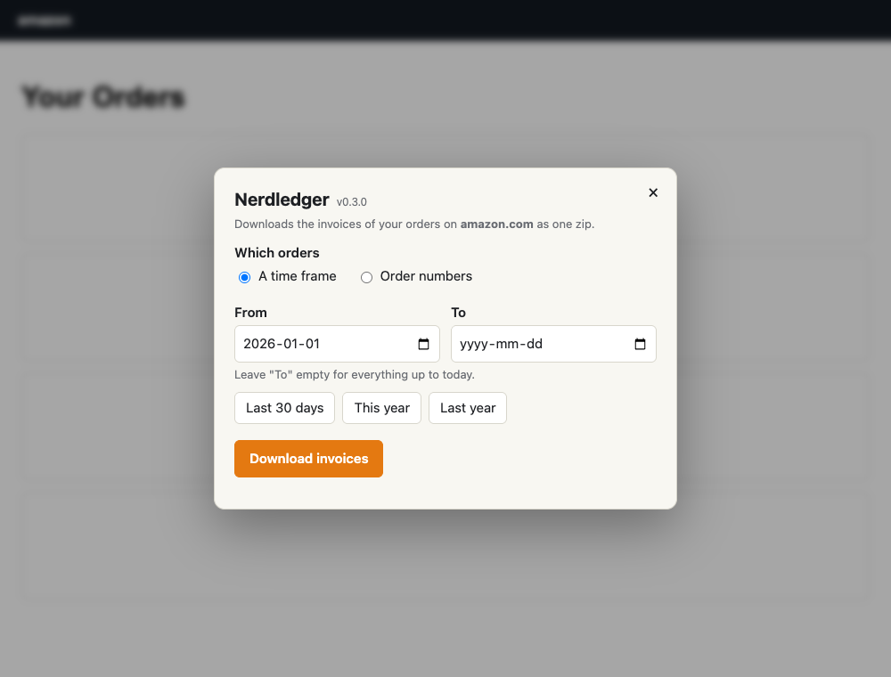

<p align="center"></p>

# Nerdledger

**Your Amazon invoices, for a time frame or single orders, in one zip.**

A small browser extension for Arc, Chrome and other Chromium browsers. Click its icon on any Amazon page, pick a
time frame (or type order numbers), and it reads the invoices of those orders and saves them as one zip.

It uses the Amazon sign-in your browser already has. It never asks for, sees or stores your password.

<p align="center"><picture>
  <source media="(prefers-color-scheme: dark)" srcset="docs/dialog-dark.png">
  
</picture></p>

## Install

1. Download the latest **Nerdledger-x.y.z.zip** from
   [Releases](https://github.com/grumpitect/nerdledger/releases/latest) and unzip it somewhere it can stay.
2. Open `chrome://extensions` (in Arc: `arc://extensions`) and turn on **Developer mode**.
3. Click **Load unpacked** and pick the **Nerdledger** folder.
4. Pin the icon, if you like.

To update, replace the folder with the new one and click the reload arrow on the extension's card.

From a clone of this repo, pick the `extension` folder instead. After changing the code, click the reload arrow on
the extension's card, then reload the Amazon tab.

## Use

1. Sign in to Amazon in the browser, if you aren't.
2. Click the icon. On an Amazon tab, the dialog opens over the page. From any other tab, it opens your orders on the
   Amazon site you used last (amazon.com the first time) and shows the dialog there.
3. Pick **A time frame** (From, and To or empty for "up to today"; or one of the presets), or **Order numbers**
   (one or more, separated by spaces, commas or new lines).
4. Click **Download invoices**. It goes oldest first: step 1 reads your order history for the time frame, step 2
   the invoices, three orders at a time. The bar and the time left are for the step it's on.

While it runs:

- **Closing the dialog** (×, Esc or a click outside it) only hides it. It keeps going; click the icon to see it again.
- **Switching tabs or windows** is fine. It keeps going in the background.
- **Leaving the page** (a link, reload or closing the tab) stops it. The browser asks first; say Stay to keep going.
- **Cancel** stops it and saves a zip of what's done so far (`..._partial.zip`).
- **Quitting the browser** or the computer sleeping loses the run. Start it again; there's no resume yet.
- **If Amazon says to slow down** (429 or a server error), it waits and tries again, up to three times.

The zip holds:

- `YYYY-MM-DD_<order number>.pdf` for orders with PDF invoices (`_1`, `_2`... when there are several, one per
  shipment or seller), which is what most sellers outside the US issue;
- `YYYY-MM-DD_<order number>.html` for orders without one: Amazon's printable order summary. Gift card purchases
  are like this, and on amazon.com most orders are. It opens in any browser, scripts removed;
- `YYYY-MM-DD_<order number>_cancelled.html` for cancelled orders: no invoice, never charged; the summary says so;
- `index.csv`: every order, oldest first, with its date, what was saved, and why an order failed, if one did.

Orders picked by number have no date in the name of a PDF (the invoice menu doesn't give one); summaries get it
from the page.

## Sites

amazon.com, .ca, .co.uk, .de, .fr, .it, .es, .nl and .com.au: the sites in `host_permissions` in
`extension/manifest.json`. It reads the page in whatever language you have it in; English is what it's mostly used
with, and dates in German, French, Spanish, Italian and Dutch are read too.

## How it works

- `background.js` handles the icon: it injects `content/panel.js` into the Amazon tab (opening one first if needed).
- `content/panel.js` loads `ui/panel.js`, the dialog, in a shadow root over the page.
- `lib/amazon.js` reads Amazon's own pages: order history (`/your-orders/orders?timeFilter=year-YYYY`), each order's
  Invoice menu (`/your-orders/invoice/popover?orderId=...`), the PDF invoices it links to, and the printable summary
  (`/gp/css/summary/print.html`).
- `lib/zip.js` writes the zip (stored, not compressed, UTF-8 names).

The requests are made from inside the Amazon tab, not from an extension page: browsers leave Amazon's SameSite=Lax
sign-in cookies out of requests from an extension's own pages, so from there you'd look signed out.

## Releases

`./release.sh` (or `./release.sh minor`, `major`, `X.Y.Z`) runs the tests, bumps the version in
`extension/manifest.json`, commits, tags, pushes and creates the GitHub release with the zip attached. It needs the
GitHub CLI (`gh`) signed in and a clean tree.

## Privacy

Everything happens in your browser. Nerdledger talks only to the Amazon site you're on, with the sign-in you already
have, and saves the zip to your downloads. It has no server, no analytics and no tracking, and sends nothing anywhere
else. It keeps four settings in the browser's extension storage: the Amazon site you used last, and the dates and
choice you last picked in the dialog. No cookies, passwords or order data are stored.

## Tests

```bash
npm install
```

```bash
npm test
```

Unit tests (dates, PDF links, the zip, checked with `unzip`) and end-to-end tests that load the extension into
Playwright's Chromium and answer its requests with sample pages shaped like Amazon's. Nothing reaches the real
network. They don't prove Amazon's real pages still look like the samples; the first real run is that check.

## Not affiliated with Amazon

Nerdledger is an independent project. It isn't made, endorsed or supported by Amazon. Amazon is a trademark of
Amazon.com, Inc. or its affiliates. It reads the same pages you see when you're signed in, so when Amazon changes
them, Nerdledger may need an update.

## License

[MIT](LICENSE).
